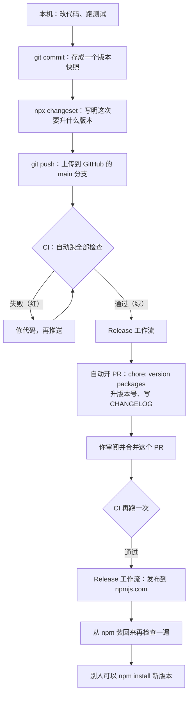
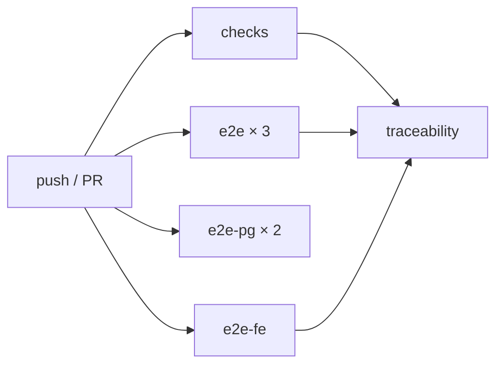
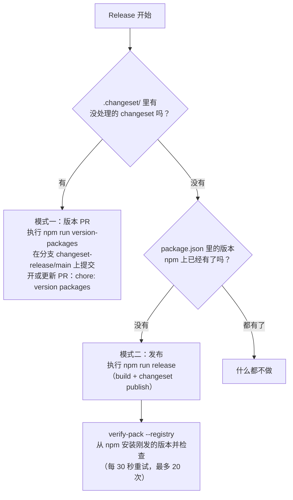
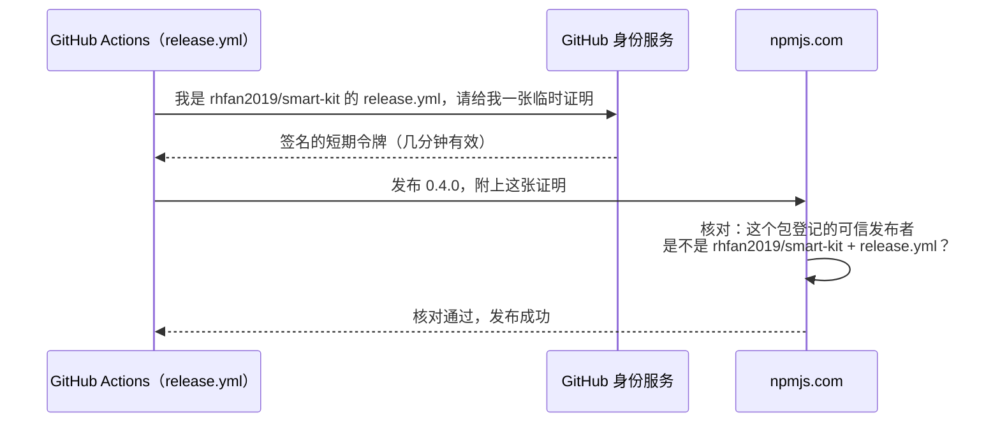
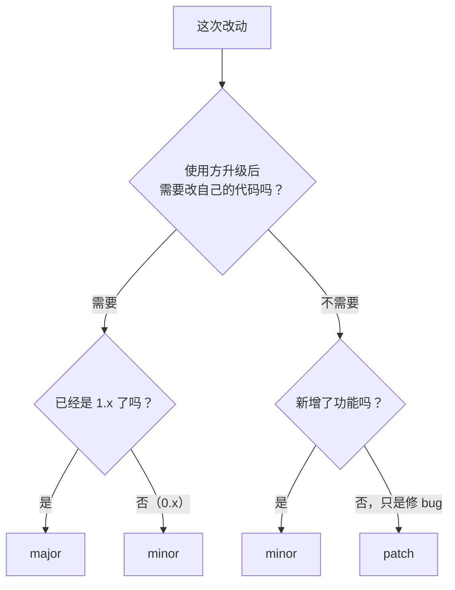

# 发版与 CI 扫盲手册

> [!abstract] 这份手册讲什么
> 以 smart-kit 为例，从零讲清楚：代码怎么从你的电脑变成别人能 `npm install` 的包；中间的 Git、GitHub、npm、Changesets、CI、GitHub Actions 分别是什么，各管哪一段；出了问题去哪里看、怎么处理。
> 每一章先讲通用概念，再讲 smart-kit 里的具体做法。

**目录**
1. [[#1. 全景图：一行代码的旅程]]
2. [[#2. Git 和 GitHub：代码放在哪里]]
3. [[#3. npm：包是什么、发到哪里]]
4. [[#4. 版本号（semver）]]
5. [[#5. Monorepo 和 workspaces]]
6. [[#6. Changesets：管版本和更新日志的工具]]
7. [[#7. CI：持续集成]]
8. [[#8. GitHub Actions：CI 运行在哪里]]
9. [[#9. smart-kit 的 CI 逐项说明]]
10. [[#10. 自动发布：Release 工作流]]
11. [[#11. 可信发布、OIDC 和 provenance]]
12. [[#12. 一次完整发版的操作清单]]
13. [[#13. 发布之后]]
14. [[#14. 常见问题和排查]]
15. [[#15. 命令速查]]
16. [[#16. 术语表]]

---

## 1. 全景图：一行代码的旅程



整个流程分三段，各有一个工具负责：

| 段 | 做什么 | 负责的工具 |
|---|---|---|
| 存代码 | 记录每次改动，和别人（或机器）共享 | Git + GitHub |
| 检查代码 | 每次推送都自动完整检查一遍 | CI（运行在 GitHub Actions 上） |
| 发布代码 | 定版本号、写更新日志、上传到公共仓库 | Changesets + npm（同样运行在 GitHub Actions 上） |

> [!tip] 一句话记住
> **Git 管历史，CI 管质量，Changesets 管版本，npm 管分发。** GitHub Actions 是运行后两者的机器。

---

## 2. Git 和 GitHub：代码放在哪里

### 2.1 Git 的基本概念

| 概念 | 含义 | 类比 |
|---|---|---|
| **仓库（repository / repo）** | 一个项目的全部代码和全部历史 | 一个带历史记录的文件夹 |
| **提交（commit）** | 一次改动的快照，带说明文字和唯一编号（如 `5de36dd`） | 存档点 |
| **分支（branch）** | 一条独立的提交线。`main` 是主线 | 平行的草稿本 |
| **远程（remote）** | 存放在另一台机器上的同一个仓库，一般叫 `origin` | 云端备份 |
| **推送（push）** | 把本机的新提交上传到远程 | 上传 |
| **拉取（pull / fetch）** | 把远程的新提交下载到本机 | 下载 |
| **合并（merge）** | 把一个分支的改动并入另一个分支 | 把草稿誊进正本 |

smart-kit 的远程是 `https://github.com/rhfan2019/smart-kit`，直接在 `main` 上开发和提交。

### 2.2 GitHub 和 Pull Request

**GitHub** 是托管 Git 仓库的网站，并提供审阅、讨论、自动化（GitHub Actions）等功能。

**Pull Request（PR，拉取请求）** 意思是"请求把分支 X 的改动合并进 main"。PR 页面上可以看到改了哪些文件、可以评论，并且会显示 CI 的检查结果。检查通过后点 **Merge** 合并。

> [!note] smart-kit 里的 PR
> 你自己开发直接提交到 main，平时用不到 PR。发版时 Changesets 会**自动开一个 PR**，标题是 `chore: version packages`。合并它，就是"同意发布"。

---

## 3. npm：包是什么、发到哪里

### 3.1 基本概念

| 概念 | 含义 |
|---|---|
| **npm** | Node.js 自带的包管理器（命令行工具），也是公共包仓库的名字 |
| **registry（仓库）** | 存放包的服务器，默认是 `https://registry.npmjs.org`，网页版是 npmjs.com |
| **包（package）** | 一个带 `package.json` 的文件夹，打成压缩包（tarball，`.tgz`）上传 |
| **scope（作用域）** | 包名前缀，如 `@rhfan2019/`，相当于命名空间，避免和别人重名 |
| **`package.json`** | 包的说明书：名字、版本、入口文件、依赖、命令脚本 |
| **`npm install`** | 从 registry 下载包并放进 `node_modules/` |
| **`npm publish`** | 把包上传到 registry |
| **`npm pack`** | 只在本地打出 `.tgz`，不上传；用来看"发布出去的包里到底有什么" |

### 3.2 `package.json` 里和发布有关的字段

```json
{
  "name": "@rhfan2019/smart-kit-core",
  "version": "0.4.0",
  "files": ["dist"],
  "exports": {
    ".": {
      "smart-kit-source": "./src/index.ts",
      "types": "./dist/index.d.ts",
      "import": "./dist/index.js"
    }
  },
  "peerDependencies": { "react": "^19.0.0" },
  "publishConfig": { "access": "public" }
}
```

- `files`：哪些文件进包。smart-kit 只发 `dist`（编译后的代码），不发源码和测试。
- `exports`：别人 `import` 时实际加载哪个文件。`smart-kit-source` 是仓库内部开发时用的自定义条件（直接读源码）；外部项目不认识这个条件，会走 `types` / `import`，也就是 `dist`（D23、D24）。
- `dependencies`：运行时需要、会一起被安装的包。
- `peerDependencies`：要求**使用方自己装**的包，比如 React。这样使用方项目里只有一份 React。
- `publishConfig.access: public`：scope 包默认是私有的（要付费），这里声明公开发布。

### 3.3 发布的几条硬规则

> [!warning] 发出去就改不了
> - **同一个版本号只能发布一次。** 0.4.0 发了之后发现问题，只能发 0.4.1，不能覆盖 0.4.0。
> - `npm unpublish`（撤回）限制很多：一般只能在发布后 72 小时内、且没有别的包依赖它时才行，而且这个版本号以后也不能再用。
> - 正常做法是发一个修复版，必要时对有问题的版本执行 `npm deprecate`：版本还在，但安装时会显示警告。

### 3.4 dist-tag（发布标签）

`npm install @rhfan2019/smart-kit` 不写版本时，安装的是 `latest` 标签指向的版本。还可以有 `next`、`beta` 等标签用来发预览版。smart-kit 目前只用 `latest`。

```bash
npm dist-tag ls @rhfan2019/smart-kit
```

---

## 4. 版本号（semver）

### 4.1 格式：`主版本.次版本.补丁版本`

| 部分 | 什么时候升 | 例子 |
|---|---|---|
| **major（主）** | 有不兼容的改动，使用方要改代码 | 1.4.2 → 2.0.0 |
| **minor（次）** | 新增功能，向后兼容 | 1.4.2 → 1.5.0 |
| **patch（补丁）** | 只修 bug | 1.4.2 → 1.4.3 |

### 4.2 0.x 阶段的特殊约定

主版本号为 0 表示"还在早期，API 可能变化"。这时惯例是：**不兼容的改动升 minor，其他改动升 patch。** smart-kit 目前处在这个阶段：0.3.0 → 0.4.0 包含不兼容的对齐改动（D49）。发 1.0.0 表示 API 稳定，之后不兼容的改动要升主版本。什么时候发 1.0 由你决定。

### 4.3 使用方写的版本范围

| 写法 | 含义 | `^0.4.0` 这类 0.x 的特殊情况 |
|---|---|---|
| `0.4.0` | 只要这一个版本 | — |
| `~0.4.0` | 允许补丁升级：`>=0.4.0 <0.5.0` | — |
| `^1.2.0` | 允许次版本和补丁升级：`>=1.2.0 <2.0.0` | `^0.4.0` 只允许 `<0.5.0`，因为 0.x 的 minor 视为不兼容 |

所以使用方如果写了 `^0.3.0`，**不会**自动升到 0.4.0，要手动改成 `^0.4.0`。

---

## 5. Monorepo 和 workspaces

**Monorepo**：多个包放在同一个仓库里。smart-kit 的结构：

```
smart-kit/
├── packages/          ← 要发布的 4 个包
│   ├── core/          @rhfan2019/smart-kit-core    模型、数据读取（不依赖 React）
│   ├── react/         @rhfan2019/smart-kit         React 组件
│   ├── server/        @rhfan2019/smart-kit-server  OData 服务端
│   └── cli/           @rhfan2019/smart-kit-cli     命令行工具
└── apps/              ← 私有，不发布
    ├── demo/  mock/  pg-server/  storybook/
```

**npm workspaces** 让这些包在本地互相引用，不用先发布。根目录的 `package.json` 里 `"workspaces": [...]` 列出了它们。`-w` 参数指定在哪个包里执行命令：

```bash
npm run build -w @rhfan2019/smart-kit-core
```

`apps/` 下的包在 `package.json` 里写了 `"private": true`，npm 会拒绝发布它们。

---

## 6. Changesets：管版本和更新日志的工具

### 6.1 为什么需要它

多个包同时维护时，手工改版本号、写更新日志很容易出错。Changesets 的做法是：**每次改动时顺手写一张"改动单"，发版时由工具统一汇总。**

### 6.2 changeset 文件长什么样

执行 `npx changeset` 后按提示选包和升级类型，会在 `.changeset/` 里生成一个随机名字的文件，例如 `.changeset/brave-lions-dance.md`：

```markdown
---
"@rhfan2019/smart-kit": minor
---

SmartTable 支持按列分组和小计。
```

- 上面 `---` 之间：哪个包、升哪一级（major / minor / patch）。
- 下面：这次改了什么，会原样写进 CHANGELOG。

这个文件和代码一起提交、推送。

### 6.3 两个命令

| 命令 | smart-kit 里的脚本 | 做什么 |
|---|---|---|
| `changeset version` | `npm run version-packages` | 读取所有 changeset，改各包 `package.json` 的版本号，写 `CHANGELOG.md`，然后**删掉**这些 changeset 文件 |
| `changeset publish` | `npm run release`（先 build） | 把 npm 上还没有的版本发布出去 |

### 6.4 smart-kit 的配置（`.changeset/config.json`）

- `"fixed": [[四个包]]`：**四个包的版本号永远一起变。** 任意一个包写了 minor，四个包都升 minor。这样使用方只要记一个版本号。
- `"access": "public"`：公开发布。
- `"baseBranch": "main"`。
- `"privatePackages": { "version": false }`：`apps/` 下的私有包不参与版本管理。

---

## 7. CI：持续集成

### 7.1 定义

**CI = Continuous Integration，持续集成。** 每次有人推送代码，都由一台干净的机器自动完整地检查一遍：能不能编译、测试过不过、规范符不符合。

要解决的问题：
- **"在我电脑上是好的"**：本机可能装了别的东西、有缓存、有没提交的文件。CI 每次从零开始，只用仓库里的内容。
- **人会忘**：不可能每次都手动跑完全部检查。CI 不会忘。
- **问题越早发现越好修**：今天推送今天就知道哪里坏了，不会等到发版那天才发现。

### 7.2 红灯和绿灯

- **绿（✅ success）**：所有检查都通过。
- **红（❌ failure）**：至少一项失败。点进去能看到是哪一步、具体报错。
- **黄（🟡 in progress）**：还在跑。

在 GitHub 仓库首页、提交记录、PR 页面上，每个提交旁边都会显示这个标记。

### 7.3 CD：持续交付 / 持续部署

经常和 CI 一起说的是 **CD（Continuous Delivery / Deployment）**：检查通过后自动交付。对网站来说是自动部署到服务器；对 smart-kit 这样的库来说，是自动发布到 npm。smart-kit 的 `ci.yml` 是 CI，`release.yml` 是 CD。

> [!important] smart-kit 的关键规则
> **CI 不绿，就不会发布。** `release.yml` 只在 CI 在 main 上成功之后才运行。

---

## 8. GitHub Actions：CI 运行在哪里

### 8.1 概念层级

```
workflow（工作流，一个 .yml 文件）
 └── job（任务，默认并行；可以用 needs 指定先后）
      └── step（步骤，按顺序执行）
           ├── run: 一条 shell 命令
           └── uses: 一个别人写好的 action（可复用的步骤）
```

| 概念 | 含义 | smart-kit 例子 |
|---|---|---|
| **workflow** | `.github/workflows/` 下的一个 YAML 文件 | `ci.yml`、`release.yml` |
| **trigger（`on:`）** | 什么事件触发它 | `push` 到 main、`pull_request`、`workflow_run`（另一个工作流完成后） |
| **runner** | 执行 job 的虚拟机，每次全新 | `ubuntu-latest`（所以截图基线是 Linux 的） |
| **job** | 一组步骤，跑在一台 runner 上 | `checks`、`e2e`、`traceability` |
| **step** | 单个步骤 | `npm ci`、`npm test` |
| **action** | 可复用步骤，用 `uses:` 引入 | `actions/checkout@v4`（拉代码）、`actions/setup-node@v4`（装 Node） |
| **matrix** | 同一个 job 按不同参数复制多份 | `shard: [1, 2, 3]`：e2e 拆成 3 份并行 |
| **services** | 给 job 附带的容器服务 | `postgres:17` 数据库 |
| **artifact** | job 产出、可下载的文件，也用于在 job 之间传数据 | 测试结果 JSON、失败时的截图 |
| **cache** | 跨运行保留的缓存，加速 | npm 依赖、SAPUI5 的 `api.json` |
| **`needs`** | 这个 job 要等哪些 job 完成 | `traceability` 等 `checks`、`e2e`、`e2e-fe` |
| **`if`** | 满足条件才运行 | 版本提交跳过 e2e |
| **concurrency** | 同一组只跑一个；新的可以取消旧的 | PR 上新推送会取消正在跑的检查 |
| **`secrets` / `permissions`** | 密钥和权限 | `GITHUB_TOKEN`、`id-token: write` |

### 8.2 `npm ci` 和 `npm install` 的区别

CI 里用的是 `npm ci`：严格按 `package-lock.json` 安装、先删掉 `node_modules`、lock 文件和 `package.json` 对不上就直接报错。保证每次装出来的依赖完全一样。本机开发用 `npm install`。

### 8.3 去哪里看

- 网页：https://github.com/rhfan2019/smart-kit/actions
- 命令行（需要先 `gh auth login`）：见 [[#15. 命令速查]]。

---

## 9. smart-kit 的 CI 逐项说明

`ci.yml` 有 5 个 job，前 4 个并行运行，最后一个等它们都完成：



### 9.1 checks（静态检查、单元测试、构建）

| 步骤 | 命令 | 检查什么 |
|---|---|---|
| 类型检查 | `npm run typecheck` | TypeScript 严格模式下没有类型错误 |
| 代码规范 | `npm run lint` | ESLint；设计令牌（`check-tokens`）；商标（不能出现 SAP、Fiori 等受保护名称） |
| 数据库准备 | `npm run pg:setup` | 建 PostgreSQL 测试库的角色、表和数据 |
| 生成文件是最新的 | `pg:generate --strict` + `git diff --exit-code` | 由数据库生成的 CSDL 和仓库里提交的一致 |
| 单元测试 | `npm test` | Vitest，约 1000 个测试 |
| UI5 对齐 | `npm run check:ui5` | 名称、API、manifest 设置与 SAPUI5 1.154 一致 |
| 构建和体积 | `npm run build` + `npm run size` | 能编译；打包体积不超标 |
| 给 AI 的文档 | `gen-agent-docs.mjs --check` | 随包文档和代码一致 |
| 安装包可用 | `npm run verify:pack` | 打出 `.tgz`，在全新项目里安装、导入、运行 CLI |
| Storybook | `npm run build-storybook` | 组件演示站能构建 |

### 9.2 e2e（端到端测试，拆成 3 份）

用 **Playwright** 打开真实的 Chromium 浏览器，像用户一样点击、输入，检查页面。还包括：
- **axe**：可访问性检查（屏幕阅读器、键盘操作等）。
- **截图对比**：和仓库里的基线截图逐像素比较。基线在 `tests/e2e/__screenshots__/linux/`，因为 CI 跑在 Linux 上；Mac 上字体渲染不同，所以本机和 CI 各有一套。
- **性能**。

**shard（分片）**：测试太多，一台机器跑太慢，就分给 3 台同时跑，每台跑三分之一。

### 9.3 e2e-pg（PostgreSQL 后端，拆成 2 份）

同样的页面，数据来自真实的 PostgreSQL 和 `smart-kit-server`，而不是模拟服务。

### 9.4 e2e-fe（与 Fiori elements 对比）

在同一台机器上启动一个真正的 Fiori elements 1.154 应用（SAPUI5 从 ui5.sap.com 加载），和 smart-kit 用同一个测试服务，逐项比较发出的请求和页面行为。

### 9.5 traceability（可追溯性）

收集前面 job 上传的测试结果，检查验收文档（`docs/13`、`docs/32` 等）里的每一条标准都对应一个通过的测试。

### 9.6 版本提交跳过 e2e

`chore: version packages` 这类提交只改版本号和 CHANGELOG，代码在推送时已经测过，所以三个 e2e job 用 `if:` 跳过，节省时间。`checks` 仍然会跑。

---

## 10. 自动发布：Release 工作流

### 10.1 触发条件

```yaml
on:
  workflow_run:
    workflows: [CI]
    types: [completed]
    branches: [main]
  workflow_dispatch:      # 也可以在网页上手动点 "Run workflow"
```

CI 在 main 上跑完后触发；job 里再判断：**CI 结论是 success，并且是 push 触发的**，才继续。CI 失败时 Release 也会出现在列表里，但显示为跳过（skipped）。

### 10.2 `changesets/action` 的两种模式

Release 的核心步骤是 `changesets/action@v1`。它每次运行都先看仓库状态，再决定做哪件事：



**为什么要中间多一个 PR？** 版本号和 CHANGELOG 是自动生成的，PR 给你一个机会在发布前看一眼：版本对不对、更新日志写得清不清楚。合并 PR = 批准发布。

**为什么最后要重试？** 新版本刚发布时，npm 的 CDN 要几分钟才能下载到（D25 实测约 5 分钟），所以检查脚本每 30 秒试一次，最多等 10 分钟。

### 10.3 权限

```yaml
permissions:
  contents: write        # 推送版本提交
  pull-requests: write   # 开 PR
  id-token: write        # 申请 OIDC 身份令牌，用于可信发布
```

仓库设置里还要打开 "Allow GitHub Actions to create and approve pull requests"，否则开不了 PR。

---

## 11. 可信发布、OIDC 和 provenance

### 11.1 传统做法的问题

以前要在 npmjs.com 生成一个 **token**（长期有效的密钥），存到 GitHub 的 secrets 里，CI 用它发布。风险是：token 一旦泄露，任何人都能以你的名义发布包。

### 11.2 可信发布（Trusted Publishing）



- **OIDC（OpenID Connect）**：一种标准的身份证明协议。GitHub 给每次运行签发一张短期的"身份证"，写明是哪个仓库、哪个工作流。
- npmjs.com 上每个包事先登记"信任哪个仓库的哪个工作流"（D24 第 6 步）。
- **不存在长期 token**，没有可泄露的东西。
- 要求 npm ≥ 11.5.1，所以 `release.yml` 里先执行 `npm install -g npm@latest`。

> [!note] 为什么第一次要手工发布
> npm 要求包已经存在，才能给它配置可信发布者。所以 0.1.0 是你在本机用 2FA 手工发布的（D25），之后才切换到自动发布。

### 11.3 Provenance（来源证明）

通过可信发布上传的包，npm 页面上会显示一个 **Provenance** 标记，写明这个包由哪个仓库的哪次提交、由哪个工作流构建。别人可以核实包确实来自公开源码，没有被人在本机改过再上传。前提是仓库是**公开**的。

### 11.4 2FA

**双因素认证**：登录或发布时，除了密码还要一个动态验证码或安全密钥。npm 要求手工发布必须开 2FA（D25 第一次发布时遇到的 E403 就是因为没开）。可信发布不需要 2FA，因为身份由 OIDC 证明。

---

## 12. 一次完整发版的操作清单

### 12.1 路径 A：标准流程（走版本 PR）

> [!example] 日常发版推荐这条路径

**开发阶段**（每次有对外可见的改动时）

- [ ] 改代码，本机跑相关测试
- [ ] `npx changeset`：选包、选 patch / minor / major，写一句改动说明
- [ ] `git add` + `git commit`（changeset 文件和代码一起提交）
- [ ] `git push`

**等 CI**

- [ ] 打开 Actions 页面，或执行 `gh run watch`，等 CI 变绿
- [ ] 如果是红的：看失败日志 → 修 → 再推送（见 [[#14. 常见问题和排查]]）

**发版**

- [ ] CI 绿了以后，Release 自动开出（或更新）PR `chore: version packages`
- [ ] 打开 PR，检查：版本号对不对，各包 `CHANGELOG.md` 的内容是否清楚
- [ ] 点 **Merge**
- [ ] 合并后 CI 再跑一次（只跑 checks 和 traceability），然后 Release 自动发布
- [ ] 在 Release 运行日志里看到 "Install the published packages from npm and check them" 通过

**确认**

- [ ] `npm view @rhfan2019/smart-kit version` 显示新版本
- [ ] npmjs.com 包页面上有 Provenance 标记
- [ ] `git pull`，把版本提交同步到本机

### 12.2 路径 B：本地直接定版本（D49 发 0.4.0 用的就是这条）

适合积累了很多 changeset、想一次性定版本，并且自己整理根目录 CHANGELOG 的情况。

- [ ] 本机执行 `npm run version-packages`：消耗掉所有 changeset、升版本号、写 CHANGELOG
- [ ] 检查改动，按需要整理 CHANGELOG
- [ ] 提交，提交信息以 `chore: version packages` 开头（这样 CI 会跳过 e2e）
- [ ] `git push`
- [ ] CI 绿 → Release 发现"没有 changeset、但版本号不在 npm 上" → 直接发布（不开 PR）

> [!warning] 路径 B 的注意点
> 提交信息以 `chore: version packages` 开头时会跳过 e2e。如果这次提交里**同时**有代码改动，这些改动就没有经过 e2e 测试。所以路径 B 的版本提交要只包含版本号和 CHANGELOG，代码改动先单独推送、等 CI 绿了再做版本提交。

### 12.3 怎么选升级类型



只改文档、测试、`apps/` 里的演示程序时，不需要写 changeset，因为它们不进发布的包。

---

## 13. 发布之后

### 13.1 使用方怎么安装和升级

```bash
npm install @rhfan2019/smart-kit@^0.4.0 @rhfan2019/smart-kit-core@^0.4.0
```

0.x 阶段从 0.3 升到 0.4 要手动改版本范围（见 [[#4.3 使用方写的版本范围]]），并且对照 CHANGELOG 和迁移清单修改代码。invoice-assure 的迁移清单在 `docs/25-invoice-assure-issues.md`。

### 13.2 发现发布的版本有问题

1. **不要试图覆盖或撤回。** 修好代码，写一个 patch changeset，正常发 0.4.1。
2. 问题严重的话，标记旧版本：
   ```bash
   npm deprecate @rhfan2019/smart-kit@0.4.0 "有 XX 问题，请升级到 0.4.1"
   ```
   四个包要分别执行。

### 13.3 本机再验证一次

```bash
node scripts/verify-pack.mjs --registry
```

从 npm 安装已发布的版本（不用本地构建），检查入口能导入、类型能解析、CLI 能运行、server 能读到数据。

---

## 14. 常见问题和排查

### 14.1 看 CI 失败原因的通用步骤

1. Actions 页面 → 点红色的那次运行 → 点红色的 job → 展开红色的 step，看最后几十行报错。
2. 或者用命令行：`gh run view --log-failed`。
3. e2e 失败时，运行页面底部 **Artifacts** 里有 `playwright-report-*`，下载后里面有失败时的截图和录像。
4. 在本机用同样的命令复现：比如 `npm run e2e -- tests/e2e/xxx.spec.ts`。

### 14.2 问题对照表

| 现象 | 可能原因 | 处理 |
|---|---|---|
| CI 里截图对比失败，本机正常 | 页面确实改了，Linux 基线没更新；或 Linux 和 Mac 渲染不同 | 下载 artifact 里的新截图，确认是预期的变化后替换 `__screenshots__/linux/` 里的基线（D49 就是这样处理的） |
| 测试在 CI 上偶尔超时，本机从不失败 | GitHub 的机器比本机慢 | 放宽等待时间或改成等待条件成立，而不是固定等几毫秒（D49 的 `SelectDialog` 焦点测试） |
| 同一个测试时好时坏（flaky） | 竞态：两件事的先后顺序不固定 | 找出依赖顺序的地方，改成明确等待；外部系统的竞态（如 FE）只在 CI 上放宽（D49 的 `lr5-initial-disabled`） |
| `npm ci` 报 lock 文件不一致 | 改了 `package.json` 没更新 `package-lock.json` | 本机 `npm install`，提交 lock 文件 |
| "Generated CSDL is up to date" 失败 | 改了数据库定义，没重新生成 | 本机 `npm run pg:generate`，提交 `apps/pg-server/generated` |
| CI 绿了，但 Release 没出现或被跳过 | CI 是 PR 触发的，不是 push 到 main；或 CI 其实失败了 | Release 只在 main 的 push 且 CI 成功后运行 |
| Release 运行了，但没开 PR 也没发布 | 没有 changeset，且当前版本 npm 上已存在 | 正常：没有需要发布的东西。要发版就先写 changeset |
| 没开出版本 PR，报权限错误 | 仓库没允许 Actions 创建 PR | 仓库 Settings → Actions → General → 勾选 "Allow GitHub Actions to create and approve pull requests" |
| 发布报 E403 / E404 / "not authorized"，提到 OIDC | npmjs.com 上没配置可信发布者，或配置的仓库名、工作流文件名不对 | 每个包页面 → Settings → Trusted Publisher，填 `rhfan2019` / `smart-kit` / `release.yml`；改好后可以在 Actions 里手动重跑 Release |
| 发布报 "cannot publish over the previously published version" | 这个版本号 npm 上已经有了 | 版本号要升一级；不能覆盖 |
| 本机手工发布报 E403，提到 two-factor | 账号没开 2FA | 在 npmjs.com 开启 2FA（D25） |
| 刚发布完 `npm view` 显示旧版本或 404 | CDN 还没同步，或本机有缓存 | 等几分钟；加 `--prefer-online` |

### 14.3 安全底线

> [!danger] 不要交给任何人（包括 AI）
> npm 密码、npm token、2FA 验证码、GitHub 个人访问令牌。需要用到这些的步骤（登录、第一次手工发布）由你自己操作。可信发布配置好以后，日常发版完全不需要它们。

---

## 15. 命令速查

### Git

```bash
git status                      # 看当前改了什么
git log --oneline -10           # 最近 10 个提交
git add -A && git commit -m "说明"
git push                        # 推送到 GitHub
git pull                        # 拉取（比如合并版本 PR 之后）
```

### Changesets

```bash
npx changeset                   # 写一张改动单
npx changeset status            # 看当前有哪些未处理的 changeset、会升到什么版本
npm run version-packages        # 本地消耗 changeset、升版本（路径 B）
```

### GitHub CLI（`gh`）

```bash
gh run list --limit 5           # 最近 5 次工作流运行
gh run watch                    # 实时看正在跑的那次
gh run view --log-failed        # 只看失败步骤的日志
gh run rerun --failed           # 只重跑失败的 job
gh pr list                      # 列出 PR（找 chore: version packages）
gh pr view --web                # 在浏览器里打开 PR
gh workflow run release.yml     # 手动触发 Release
```

### npm

```bash
npm view @rhfan2019/smart-kit version          # npm 上的最新版本
npm view @rhfan2019/smart-kit versions --json  # 所有已发布的版本
npm dist-tag ls @rhfan2019/smart-kit           # 发布标签
npm pack --dry-run -w @rhfan2019/smart-kit-core  # 看包里会有哪些文件
npm whoami                                     # 本机当前登录的 npm 账号
```

### smart-kit 的检查（本机跑一遍，对应 CI 的 checks）

```bash
npm run typecheck
npm run lint
npm test
npm run check:ui5
npm run build
npm run size
npm run verify:pack
npm run e2e
```

---

## 16. 术语表

| 术语 | 解释 |
|---|---|
| action | GitHub Actions 里可复用的步骤，用 `uses:` 引入 |
| artifact | 工作流运行产出、可下载的文件 |
| baseline（基线） | 截图测试里作为标准答案的截图 |
| branch（分支） | 一条独立的提交线 |
| CD | 持续交付 / 持续部署：检查通过后自动发布 |
| changeset | 描述"升哪个包、升哪级、改了什么"的小文件 |
| CHANGELOG | 版本更新日志 |
| CI | 持续集成：每次推送都自动检查 |
| commit（提交） | 一次改动的快照 |
| CDN | 内容分发网络；npm 的包文件通过它下载，新版本要几分钟同步 |
| deprecate | 把某个版本标记为不推荐，安装时显示警告 |
| dist | 编译后的代码目录，是真正发布出去的内容 |
| dist-tag | npm 的发布标签，如 `latest` |
| e2e | 端到端测试：在真实浏览器里像用户一样操作 |
| exports | `package.json` 里声明外部能导入哪些入口 |
| fixed 组 | Changesets 配置：组内的包版本号永远一致 |
| flaky test | 时好时坏的测试，通常是竞态或超时引起 |
| job | 工作流里的一个任务，跑在一台 runner 上 |
| lint | 静态代码规范检查 |
| lock 文件 | `package-lock.json`，锁定每个依赖的精确版本 |
| matrix | 把同一个 job 按不同参数复制成多份 |
| merge（合并） | 把一个分支的改动并入另一个 |
| monorepo | 多个包放在同一个仓库 |
| OIDC | 一种身份证明协议；可信发布用它代替 token |
| peerDependency | 要求使用方自己安装的依赖（如 React） |
| provenance | npm 上的来源证明：包由哪个仓库、哪次提交构建 |
| PR（Pull Request） | 请求把分支合并进 main，可审阅、可跑检查 |
| registry | 存放 npm 包的服务器 |
| remote | 远程仓库，一般叫 `origin` |
| runner | 执行 job 的虚拟机 |
| scope | npm 包名前缀，如 `@rhfan2019/` |
| semver | 语义化版本：主.次.补丁 |
| shard（分片） | 把测试拆成几份，在多台机器上并行跑 |
| step | job 里的一个步骤 |
| tarball | 包的压缩文件（`.tgz`） |
| token | 长期有效的访问密钥 |
| traceability（可追溯性） | 每条验收标准都对应一个通过的测试 |
| trusted publishing | 可信发布：npm 只信任登记过的仓库和工作流，不用 token |
| 2FA | 双因素认证 |
| workflow | 工作流，`.github/workflows/` 下的一个 YAML 文件 |
| workflow_run | 触发条件：另一个工作流运行完成后 |
| workspaces | npm 的 monorepo 支持，本地包之间可以互相引用 |

---

> [!info] 相关文档
> - `docs/adr/` 里的 ADR-029（发版和可信发布）、ADR-030（给 AI 编程工具的文档）
> - `docs/12-discussion-log.md`：D23、D24（发布准备）、D25（第一次发布）、D26（自动发布）、D49（发版 0.4.0）
> - `.github/workflows/ci.yml`、`.github/workflows/release.yml`
> - `.changeset/config.json`、`.changeset/README.md`
